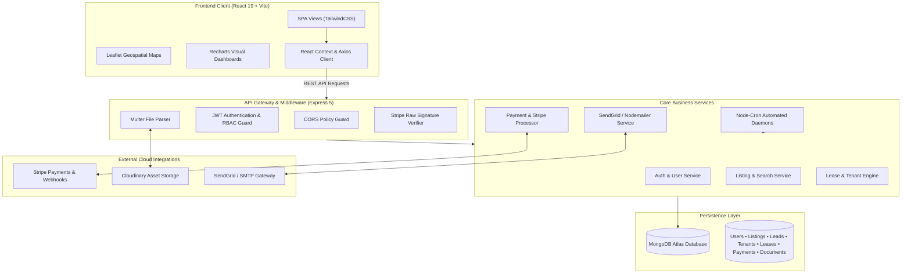

<div align="center">

# 🏢 PropEx — Real Estate Management System (REMS)
### *Enterprise-Grade Property Marketplace, Tenancy Management & Financial Automation Platform*

<p align="center">
  <a href="https://nodejs.org/"></a>
  <a href="https://expressjs.com/"></a>
  <a href="https://react.dev/"></a>
  <a href="https://vitejs.dev/"></a>
  <a href="https://www.mongodb.com/"></a>
  <a href="https://tailwindcss.com/"></a>
  <a href="https://stripe.com/"></a>
  <a href="#license"></a>
</p>

<br/>

**PropEx** is a production-ready, full-stack Real Estate Management Platform designed to streamline interactions between **Property Buyers**, **Tenants**, **Property Managers/Agents**, **Landlords/Owners**, and **Platform Administrators**. It bridges high-converting property discovery with automated tenancy lifecycles, automated rent collection, interactive geospatial mapping, and role-segregated executive dashboards.

<p align="center">
  <a href="#key-features">Explore Features</a> •
  <a href="#system-architecture">System Architecture</a> •
  <a href="#role-based-access-control-rbac">Role Matrix</a> •
  <a href="#getting-started">Quick Start</a> •
  <a href="#api-reference">API Specification</a> •
  <a href="#documentation--workflows">Documentation</a>
</p>

---
</div>

## 📑 Table of Contents
- [Executive Overview](#executive-overview)
- [Key Features](#key-features)
- [System Architecture](#system-architecture)
- [Role-Based Access Control (RBAC)](#role-based-access-control-rbac)
- [Tech Stack](#tech-stack)
- [Directory Structure](#directory-structure)
- [Getting Started](#getting-started)
  - [Prerequisites](#prerequisites)
  - [Installation](#installation)
  - [Environment Variables](#environment-variables)
  - [Running the Application](#running-the-application)
- [API Reference](#api-reference)
- [Automated Background Workers](#automated-background-workers)
- [Testing & Quality Assurance](#testing--quality-assurance)
- [Documentation & Workflows](#documentation--workflows)
- [Security & Compliance](#security--compliance)
- [Contributing](#contributing)
- [License](#license)

---

## <a id="executive-overview"></a>🌟 Executive Overview

Modern real estate workflows often suffer from fragmented communication, manual lease management, and delayed payment reconciliations. **PropEx** consolidates the entire real estate lifecycle into a single unified platform:

- **For Buyers & Renters:** Instant search with interactive Leaflet map discovery, high-resolution Cloudinary image galleries, and structured inquiry dispatch.
- **For Tenants:** Frictionless digital lease signing, monthly digital rent invoices, Stripe-powered payments, and a secure personal document vault.
- **For Property Managers:** Automated lead pipelines, lease lifecycles, tenant management, and inspection tracking.
- **For Property Owners:** Real-time visibility into portfolio occupancy, revenue statements, and manager assignments.
- **For Administrators:** Super-user controls, global platform analytics via Recharts, dispute escalation management, and tenant audit trails.

---

## <a id="key-features"></a>🚀 Key Features

### 🔍 1. Interactive Property Discovery & Geospatial Search
- **Geospatial Mapping:** Interactive map browsing powered by **Leaflet** & **React-Leaflet** with customized map markers and bounds search.
- **Multi-Parameter Filtering:** Search properties by budget (standardized in ₹ INR, Lakhs/Crores), property type (Apartment, Villa, Commercial, Studio), BHK configuration, and location.
- **Media Asset Pipeline:** Cloud-stored property visuals managed via **Multer** and optimized through **Cloudinary CDN**.

### 👥 2. Enterprise Role-Based Access Control (RBAC)
- Five distinct operational roles: **Buyer**, **Tenant**, **Manager**, **Owner**, and **Admin**.
- JWT-authenticated stateless sessions with role-restricted route guards on both backend endpoints and frontend views.

### 📜 3. End-to-End Lease Management
- Digital lease authoring with dynamic start/end dates, monthly rental commitments, and security deposits.
- Real-time lease status progression (`Pending`, `Active`, `Expiring`, `Terminated`).
- Digital tenant onboarding with secure KYC document attachments.

### 💳 4. Automated Financial Billing & Stripe Gateway
- Automated monthly rent invoice generation.
- Secure credit/debit card checkout through **Stripe API**.
- Dedicated Stripe Webhook reconciliation endpoint (`/api/webhooks/stripe`) verifying raw cryptographic signatures to prevent payment tampering.
- Overdue balance tracking and automated ledger updates.

### ⏰ 5. Autonomous Background Daemons (Node-Cron)
- **Daily Midnight Cron Job:** Automatically scans active leases to:
  - Identify leases expiring within the next 30 days and alert stakeholders.
  - Detect upcoming rent deadlines and dispatch reminder emails.
  - Flag overdue rent accounts and trigger penalty notices.
  - Generate new monthly payment invoices for active tenancies.

### 📊 6. Analytics & Performance Intelligence
- Dynamic visual reports powered by **Recharts**.
- Platform-wide telemetry on transaction volume, occupancy ratios, monthly gross revenue, and user acquisition metrics.

### 📧 7. Multi-Channel Notification Engine
- Automated transactional email dispatches via **SendGrid Mail** and **Nodemailer**.
- Instant email delivery for authentication events, inquiry updates, lease renewal notices, and payment receipts.

---

## <a id="system-architecture"></a>🏛️ System Architecture



---

## <a id="role-based-access-control-rbac"></a>🛡️ Role-Based Access Control (RBAC)

PropEx enforces strict role separation across the application:

| Feature / Module | 🛒 Buyer | 🏠 Tenant | 👔 Manager | 🏢 Owner | 👑 Admin |
|:---|:---:|:---:|:---:|:---:|:---:|
| Search & Filter Properties | ✅ | ✅ | ✅ | ✅ | ✅ |
| Interactive Map Browsing | ✅ | ✅ | ✅ | ✅ | ✅ |
| Submit Property Inquiries | ✅ | ❌ | ❌ | ❌ | ❌ |
| View Personal Leases & Invoices | ❌ | ✅ | ❌ | ❌ | ❌ |
| Digital Rent Payment (Stripe) | ❌ | ✅ | ❌ | ❌ | ❌ |
| Upload KYC & Rental Documents | ❌ | ✅ | ❌ | ❌ | ❌ |
| Manage Assigned Property Leads | ❌ | ❌ | ✅ | ❌ | ✅ |
| Draft Leases & Tenant Records | ❌ | ❌ | ✅ | ❌ | ✅ |
| View Owner Portfolio & Income | ❌ | ❌ | ❌ | ✅ | ✅ |
| Assign Property Managers | ❌ | ❌ | ❌ | ✅ | ✅ |
| Platform-Wide User Moderation | ❌ | ❌ | ❌ | ❌ | ✅ |
| System-Wide Analytics & Metrics | ❌ | ❌ | ❌ | ❌ | ✅ |

> 📖 **Deep Dive:** Comprehensive specifications and operational workflows for every role are documented in the [`/docs/roles`](docs/roles/) directory:
> - [Admin Specification](docs/roles/admin.md)
> - [Buyer Specification](docs/roles/buyer.md)
> - [Manager Specification](docs/roles/manager.md)
> - [Owner Specification](docs/roles/owner.md)
> - [Tenant Specification](docs/roles/tenant.md)

---

## <a id="tech-stack"></a>💻 Tech Stack

### Frontend Application
- **Runtime & Framework:** [React 19](https://react.dev/) with [Vite](https://vitejs.dev/)
- **Routing:** [React Router DOM v7](https://reactrouter.com/)
- **Styling:** [TailwindCSS v3.4](https://tailwindcss.com/) with PostCSS & Autoprefixer
- **Mapping:** [Leaflet](https://leafletjs.com/) & [React-Leaflet v5](https://react-leaflet.js.org/)
- **Data Visualization:** [Recharts v3](https://recharts.org/)
- **Forms & Validation:** [React Hook Form](https://react-hook-form.com/) & [Zod](https://zod.dev/)
- **Icons & Notifications:** [Lucide React](https://lucide.dev/) & [React Hot Toast](https://react-hot-toast.com/)
- **API Client:** [Axios](https://axios-http.com/)

### Backend Application
- **Runtime:** [Node.js](https://nodejs.org/) (ES Modules)
- **Framework:** [Express.js v5.1](https://expressjs.com/)
- **Database & ODM:** [MongoDB](https://www.mongodb.com/) via [Mongoose v8.19](https://mongoosejs.com/)
- **Authentication:** [JSON Web Tokens (JWT)](https://jwt.io/) & [bcryptjs](https://github.com/dcodeIO/bcrypt.js)
- **Payments:** [Stripe Node SDK](https://stripe.com/docs/api) with Webhooks
- **Asset Storage:** [Cloudinary SDK](https://cloudinary.com/) & [Multer](https://github.com/expressjs/multer)
- **Task Scheduling:** [Node-Cron](https://github.com/node-cron/node-cron)
- **Email Delivery:** [@sendgrid/mail](https://sendgrid.com/) & [Nodemailer](https://nodemailer.com/)
- **Testing:** [Jest](https://jestjs.io/) & [Supertest](https://github.com/ladjs/supertest)

---

## <a id="directory-structure"></a>📂 Directory Structure

```text
PropEx/
├── backend/                         # Node.js + Express 5 API Server
│   ├── src/
│   │   ├── __tests__/               # Jest & Supertest integration test suites
│   │   ├── config/                  # Database (db.js) & cloud configurations
│   │   ├── controllers/             # Business logic & request controllers
│   │   │   ├── authController.js
│   │   │   ├── listingController.js
│   │   │   ├── leaseController.js
│   │   │   ├── paymentController.js
│   │   │   ├── webhook.js           # Stripe webhook processing
│   │   │   └── ...
│   │   ├── middleware/              # Auth guards, role verifiers, uploads
│   │   ├── models/                  # Mongoose data schemas
│   │   │   ├── User.js              # Auth & role definitions
│   │   │   ├── Listing.js           # Property listing schema
│   │   │   ├── Lease.js             # Lease agreements & statuses
│   │   │   ├── Tenant.js            # Tenant profiles & assignments
│   │   │   ├── Lead.js              # Customer inquiries & status
│   │   │   ├── Payment.js           # Invoices & Stripe transaction records
│   │   │   └── Document.js          # KYC & agreement file records
│   │   ├── routes/                  # Express API routers
│   │   ├── services/                # Notification & billing domain services
│   │   ├── utils/                   # Helper functions & sanitizers
│   │   └── server.js                # App entrypoint & cron worker schedule
│   ├── package.json
│   └── jest.config.js
│
├── frontend/                        # React 19 + Vite Single Page Application
│   ├── src/
│   │   ├── components/              # Modular UI components (Navbar, Footer, Modals)
│   │   ├── context/                 # Context providers (AuthContext, etc.)
│   │   ├── pages/                   # Application route pages
│   │   │   ├── HomePage.jsx         # Hero landing & featured properties
│   │   │   ├── ListingPage.jsx      # Search with Leaflet map & filters
│   │   │   ├── PropertyDetails.jsx  # Detailed property showcase
│   │   │   ├── BuyerDashboard.jsx   # Buyer inquiries & saved listings
│   │   │   ├── TenantDashboard.jsx  # Lease viewer, rent payments, docs
│   │   │   ├── AgentDashboard.jsx   # Manager lead pipeline & property roster
│   │   │   ├── AdminDashboard.jsx   # Admin controls & user oversight
│   │   │   ├── admin/Analytics.jsx  # Recharts performance telemetry
│   │   │   └── leases/              # Lease creation & detailed inspection
│   │   ├── App.jsx                  # Main route mapping & guards
│   │   ├── main.jsx                 # React root bootstrap
│   │   └── index.css                # TailwindCSS base & custom utilities
│   ├── package.json
│   └── vite.config.js
│
├── docs/                            # Comprehensive documentation & workflows
│   └── roles/                       # Detailed role guides (Admin, Buyer, Manager, Owner, Tenant)
└── README.md                        # Master project documentation
```

---

## <a id="getting-started"></a>⚡ Getting Started

### Prerequisites
Make sure the following tools and services are installed/configured:
- [Node.js](https://nodejs.org/) `>= 18.0.0`
- [npm](https://www.npmjs.com/) `>= 9.0.0`
- [MongoDB Atlas](https://www.mongodb.com/cloud/atlas) or a local MongoDB instance running on `localhost:27017`
- A [Cloudinary Account](https://cloudinary.com/) (for property photo uploads)
- A [Stripe Account](https://stripe.com/) (for payment processing and webhooks)
- A [SendGrid Account](https://sendgrid.com/) or SMTP credentials (for email notifications)

---

### Installation

1. **Clone the repository:**
   ```bash
   git clone https://github.com/balajirapolu/PropEx-RealEstate-MS.git
   cd PropEx-RealEstate-MS
   ```

2. **Install backend dependencies:**
   ```bash
   cd backend
   npm install
   ```

3. **Install frontend dependencies:**
   ```bash
   cd ../frontend
   npm install
   ```

---

### Environment Variables

#### Backend Configuration
Create a `.env` file inside the `backend/` directory:

```env
# Server Configuration
PORT=5001
NODE_ENV=development
FRONTEND_URL=http://localhost:5173

# Database Connection
MONGO_URI=mongodb+srv://<username>:<password>@cluster0.mongodb.net/propex?retryWrites=true&w=majority

# Authentication Secrets
JWT_SECRET=your_super_secret_jwt_key_here
JWT_EXPIRES_IN=7d

# Cloudinary Storage
CLOUDINARY_CLOUD_NAME=your_cloudinary_cloud_name
CLOUDINARY_API_KEY=your_cloudinary_api_key
CLOUDINARY_API_SECRET=your_cloudinary_api_secret

# Stripe Payments & Webhooks
STRIPE_SECRET_KEY=sk_test_your_stripe_secret_key
STRIPE_WEBHOOK_SECRET=whsec_your_stripe_webhook_secret

# Email Services (SendGrid / SMTP)
SENDGRID_API_KEY=SG.your_sendgrid_api_key
EMAIL_FROM=noreply@propex.com
```

#### Frontend Configuration
Create a `.env.local` or `.env` file inside the `frontend/` directory:

```env
# Backend API Base Endpoint
VITE_API_BASE_URL=http://localhost:5001/api
```

---

### Running the Application

#### 1. Start the Backend API Server
```bash
cd backend
npm run dev
```
*The API server will initialize on `http://localhost:5001` with scheduled cron jobs and database connectivity.*

#### 2. Start the Frontend Application
```bash
cd frontend
npm run dev
```
*The Vite development server will boot on `http://localhost:5173`.*

---

## <a id="api-reference"></a>📡 API Reference

All backend routes are prefixed with `/api`. Protected routes require a Bearer token in the `Authorization` header (`Bearer <token>`).

### Authentication & Users (`/api/auth`, `/api/users`)
| Method | Endpoint | Access | Description |
|:---|:---|:---|:---|
| `POST` | `/api/auth/register` | Public | Register new user (Buyer, Owner, Manager, etc.) |
| `POST` | `/api/auth/login` | Public | Authenticate user & return JWT session token |
| `GET` | `/api/users/profile` | Authenticated | Retrieve authenticated user profile |
| `GET` | `/api/users` | Admin | Retrieve paginated list of all system users |
| `PATCH` | `/api/users/:id/role` | Admin | Update role or operational status of a user |

### Property Listings (`/api/listings`)
| Method | Endpoint | Access | Description |
|:---|:---|:---|:---|
| `GET` | `/api/listings` | Public | Query listings with price, location, BHK filters |
| `GET` | `/api/listings/:id` | Public | Get comprehensive details of a single property |
| `POST` | `/api/listings` | Owner / Manager / Admin | Publish a new property with Cloudinary media |
| `PUT` | `/api/listings/:id` | Owner / Manager / Admin | Modify property details, pricing, or status |
| `DELETE` | `/api/listings/:id` | Owner / Admin | Unlist or remove property from marketplace |

### Leads & Inquiries (`/api/leads`)
| Method | Endpoint | Access | Description |
|:---|:---|:---|:---|
| `POST` | `/api/leads` | Public / Buyer | Submit an inquiry or request a site visit |
| `GET` | `/api/leads` | Manager / Admin | Fetch inquiries assigned to manager or platform |
| `PATCH` | `/api/leads/:id/status`| Manager / Admin | Update lead status (`New`, `Contacted`, `Closed`) |

### Leases & Tenancies (`/api/leases`, `/api/tenants`)
| Method | Endpoint | Access | Description |
|:---|:---|:---|:---|
| `POST` | `/api/leases` | Manager / Admin | Draft a new formal lease agreement |
| `GET` | `/api/leases/my-leases`| Tenant | Retrieve tenant's active and historical leases |
| `GET` | `/api/leases` | Manager / Owner / Admin | List all platform lease contracts |
| `GET` | `/api/tenants` | Manager / Admin | Retrieve full tenant registry and payment health |

### Payments & Invoicing (`/api/payments`)
| Method | Endpoint | Access | Description |
|:---|:---|:---|:---|
| `GET` | `/api/payments/tenant` | Tenant | View personal rent dues, receipts, and invoices |
| `POST` | `/api/payments/checkout`| Tenant | Create Stripe Checkout session for rent payment |
| `POST` | `/api/webhooks/stripe` | Stripe Service | Verify webhook signature and record payment |

### Platform Analytics (`/api/analytics`)
| Method | Endpoint | Access | Description |
|:---|:---|:---|:---|
| `GET` | `/api/analytics/overview`| Admin | Retrieve platform revenue, occupancy, and leads |

---

## <a id="automated-background-workers"></a>⏰ Automated Background Workers

The backend utilizes `node-cron` to execute automated scheduled maintenance routines daily at midnight (`0 0 * * *`):

```javascript
cron.schedule('0 0 * * *', async () => {
  await checkExpiringLeases();      // Flags leases within 30 days of expiry
  await checkUpcomingRent();        // Sends reminders 3 days prior to due date
  await checkOverdueRent();         // Flags delinquent accounts & notifies managers
  await generateMonthlyPayments();  // Issues new billing cycles for active leases
});
```

---

## <a id="testing--quality-assurance"></a>🧪 Testing & Quality Assurance

PropEx includes automated testing with Jest and Supertest to validate endpoints and data consistency:

```bash
cd backend

# Run all test suites
npm test

# Run tests in watch mode
npm run test:watch

# Generate code coverage report
npm run test:coverage
```

Frontend linting:
```bash
cd frontend
npm run lint
```

---

## <a id="documentation--workflows"></a>📚 Documentation & Workflows

Comprehensive documentation for all five platform roles is maintained inside the [`/docs/roles`](docs/roles/) directory:

- 🔑 **[Admin Operations Guide](docs/roles/admin.md):** User governance, global moderation, dispute settlement, platform metrics.
- 🛒 **[Buyer Guide](docs/roles/buyer.md):** Search filtering, tour scheduling, favorites list, agent messaging.
- 👔 **[Manager Guide](docs/roles/manager.md):** Lead pipeline, lease drafting, tenant onboarding, maintenance oversight.
- 🏢 **[Owner Guide](docs/roles/owner.md):** Portfolio management, revenue distributions, manager delegation.
- 🏠 **[Tenant Guide](docs/roles/tenant.md):** Digital onboarding, document vault, Stripe rent payments, lease renewals.

---

## <a id="security--compliance"></a>🔒 Security & Compliance

- **Cryptographic Hashing:** Passwords securely hashed with `bcryptjs` using dynamic salts before persistence.
- **Stateless Tokens:** Signed JWT tokens with strict expiration thresholds.
- **Webhook Integrity:** Stripe webhooks are processed using raw buffers with cryptographic signature verification (`stripe-signature`) to prevent replay attacks.
- **CORS Protection:** Configurable origin whitelisting ensures only authorized frontend applications communicate with the backend.
- **File Sanitization:** Multer file-type validation restricts uploads to certified media formats before transmitting to Cloudinary.

---

## <a id="contributing"></a>🤝 Contributing

Contributions are welcomed! Follow these standard practices:

1. **Fork the Repository**
2. **Create a Feature Branch:**
   ```bash
   git checkout -b feature/AmazingFeature
   ```
3. **Commit Your Changes:**
   ```bash
   git commit -m "feat: Add AmazingFeature with comprehensive tests"
   ```
4. **Push to the Branch:**
   ```bash
   git push origin feature/AmazingFeature
   ```
5. **Open a Pull Request**

---

## <a id="license"></a>📄 License

This project is licensed under the **ISC License**. Feel free to use, modify, and distribute according to the terms of the license.

---

<div align="center">
  Developed by <a href="https://github.com/balajirapolu"><strong>Balaji Rapolu</strong></a> • Built with modern web standards
</div>
